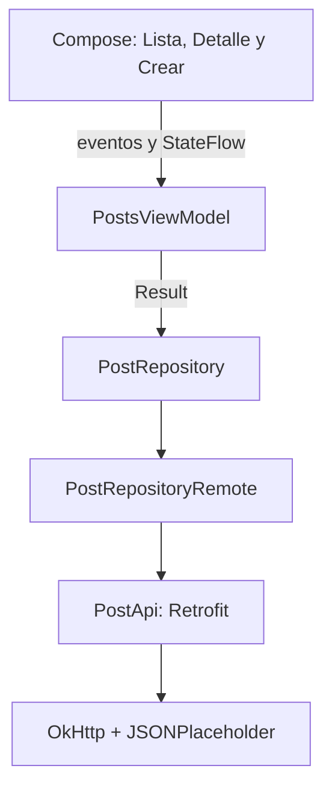

# MuroCampus

Aplicación Android de la Semana 9 para consultar publicaciones de JSONPlaceholder, ver comentarios, filtrar por usuario y simular la creación de publicaciones.

## Tecnologías

- Kotlin 2.0.21, Jetpack Compose y Material 3.
- MVVM + Repository con `StateFlow`.
- Retrofit 2.11, OkHttp 4.12 y kotlinx.serialization 1.7.3.
- JSONPlaceholder: `https://jsonplaceholder.typicode.com/`.

## Requisitos y ejecución

- Android Studio con JDK 11 o superior y Android SDK 35.
- Conexión a internet para sincronizar Gradle y consultar JSONPlaceholder.
- Abrir esta carpeta (`SEMANA 09/MuroCampus`) en Android Studio, sincronizar Gradle y ejecutar la configuración `app` en un emulador o dispositivo.

La aplicación requiere el permiso `INTERNET`. JSONPlaceholder simula el POST: informa el id 101, pero no conserva la publicación.

## Paquetes

```text
com.tecsup.murocampus/
├── MainActivity.kt
├── model/Modelos.kt
├── data/
│   ├── PostRepository.kt
│   └── remote/ (PostApi.kt, RetrofitClient.kt)
├── viewmodel/ (UiState.kt, PostsViewModel.kt, PostsViewModelFactory.kt)
└── ui/ (Componentes.kt, PantallaLista.kt, PantallaDetalle.kt, PantallaCrear.kt, theme/Theme.kt)
```

## Arquitectura



La UI solo presenta `UiState` y envía acciones al ViewModel. El ViewModel conoce la interfaz `PostRepository`; el Repository captura errores de red y vuelve a lanzar cancelaciones. Retrofit vive en `data/remote`.

## Funcionalidades

- Lista con estados de carga, éxito y error, botón Reintentar y etiqueta `Usuario N`.
- Filtro por Todos y usuarios 1–10 mediante `@Query("userId")`.
- Detalle y comentarios mediante `@Path`; el botón Atrás vuelve a la lista conservada en el ViewModel.
- Formulario de publicación con validación, estado de envío, resultado y mensaje de error que conserva el texto.

## Capturas

No se generaron capturas de la aplicación porque no se logró completar una ejecución en emulador. Estos cinco archivos quedan pendientes y no se han inventado:

1. `capturas/lista.png`
2. `capturas/detalle.png`
3. `capturas/filtro.png`
4. `capturas/crear.png`
5. `capturas/error-conexion.png`

## Para pensar

1. **GET y POST; `@Body` y `@Query`:** GET lee recursos y POST envía datos para crear uno. `@Body` serializa `NuevoPost` como JSON en el cuerpo; `@Query` agrega `userId` a la URL para filtrar la colección.
2. **Ruta `posts`:** la URL base ya termina en `/`. Retrofit combina la base y la ruta; empezar la ruta con `/` puede descartar el camino de la base.
3. **`Result` en Repository:** representa éxito o error como valor, mantiene el límite de errores en la capa de datos y permite al ViewModel convertirlos en estados de pantalla. La cancelación de corrutinas se relanza.
4. **Permiso e `ignoreUnknownKeys`:** sin `INTERNET`, Android bloquea las llamadas de red. `ignoreUnknownKeys = true` deja leer respuestas que añaden campos no modelados; sin esa opción, la deserialización puede fallar.
5. **`when` sobre `UiState`:** los estados Cargando, Exito y Error son mutuamente excluyentes; el `when` obliga a mostrar la vista correspondiente a un único estado coherente.
6. **Servicio real:** habría que configurar su URL, autenticación, contratos y errores; el POST persistiría según el servidor, por lo que la app podría actualizar la lista con la respuesta guardada.

## Validación

`assembleDebug` compiló correctamente en `main` con Gradle 8.13 y JDK 17. En este equipo, el Java predeterminado apunta a un lanzador antiguo y Android Studio incluye JDK 25; para repetir la compilación aquí se seleccionó temporalmente JDK 17. No se ejecutó la app en emulador ni se verificaron visualmente las llamadas HTTP. Las cinco capturas siguen pendientes.
