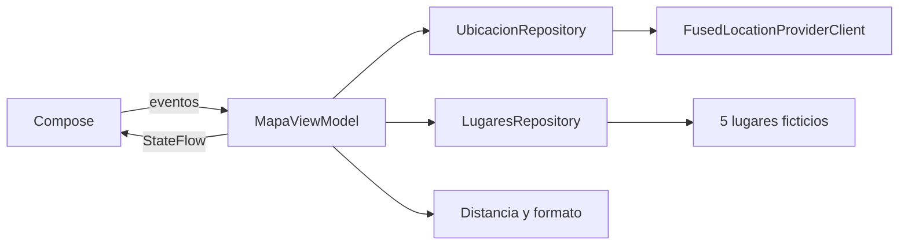
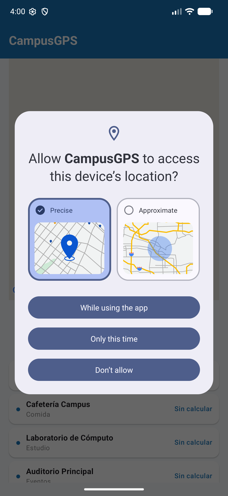
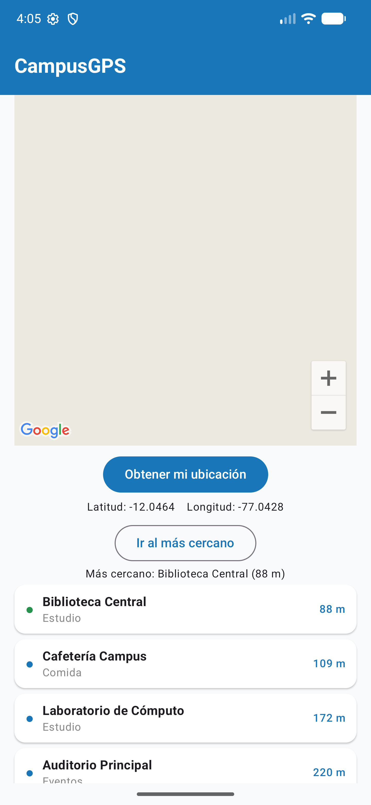
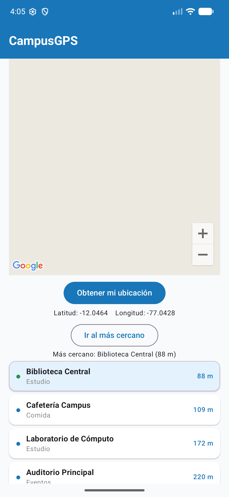
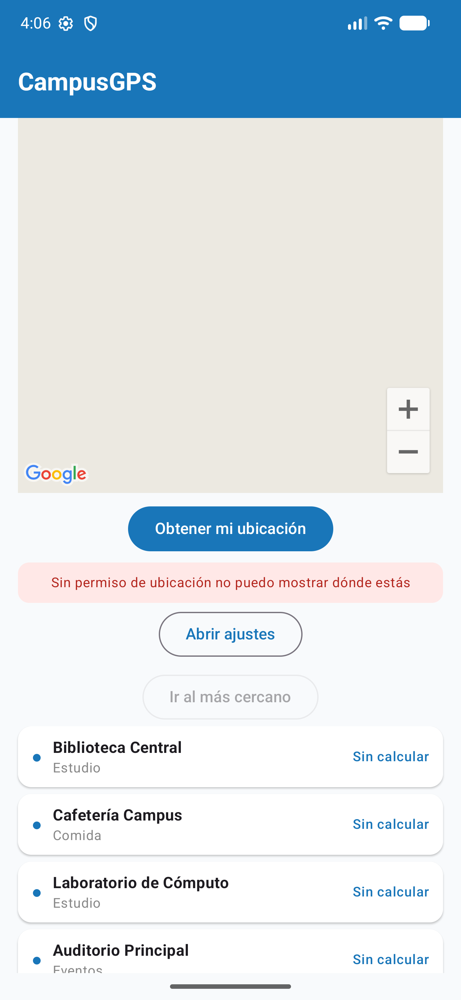

# CampusGPS

Aplicación Android en Kotlin y Jetpack Compose que muestra la ubicación actual y cinco lugares ficticios del campus sobre Google Maps. Calcula y ordena las distancias en el ViewModel; la interfaz observa sus `StateFlow`.

## Requisitos

- Android Studio, JDK 17, Gradle Wrapper y Android SDK 35.
- Emulador o dispositivo con Google Play Services.
- Una clave de Google Maps con Maps SDK for Android habilitado.

## Configuración local

En `local.properties` (ignorado por Git), conserva `sdk.dir` y configura:

```properties
MAPS_API_KEY=tu_clave_de_google_maps
```

En Google Cloud, restringe la clave al paquete `com.suarez.campusgps` y a la huella SHA-1 de la variante que ejecutas (`./gradlew signingReport`). La clave no se guarda en el código ni se sube al repositorio. Si cambias de paquete, actualiza también esta restricción.

## Ejecutar

Abre `SEMANA 13/CampusGPS` en Android Studio, selecciona JDK 17 para Gradle y sincroniza el proyecto. Ejecuta la configuración `app` en un emulador con Google Play. En el emulador puedes simular la ubicación desde **Extended controls → Location**.

## Arquitectura y paquetes

- `ui/`: pantalla Compose, mapa, lista de lugares y mensajes de error.
- `viewmodel/`: `MapaViewModel`, lógica de distancias y `StateFlow`.
- `data/`: interfaces de repositorio y proveedores local/Google.
- `model/`: modelos y estados.
- `util/`: cálculo y formato de distancias.

```text
com.suarez.campusgps/
├── MainActivity.kt
├── data/
│   ├── LugaresRepository.kt
│   ├── LugaresRepositoryLocal.kt
│   ├── UbicacionRepository.kt
│   └── UbicacionRepositoryGoogle.kt
├── model/Modelos.kt
├── ui/
│   ├── ListaLugares.kt
│   ├── MapaUbicacion.kt
│   ├── MensajeError.kt
│   ├── PantallaMapa.kt
│   └── theme/Theme.kt
├── util/{Distancia,Formato}.kt
└── viewmodel/MapaViewModel.kt
```



## Capturas

Las capturas se tomaron en un emulador Android. Google Maps necesita una clave autorizada para el paquete y la huella de firma actuales para renderizar el mapa.

| Permiso | Mapa y ubicación | Marcadores y distancias |
|---|---|---|
|  |  |  |

| Selección del lugar más cercano | Estado de error |
|---|---|
|  |  |

## Respuestas para la reflexión

1. `FusedLocationProviderClient` queda dentro del Repository para aislar Google Play Services. El ViewModel depende de `UbicacionRepository`, lo que permite cambiar la fuente de ubicación sin acoplar la UI.
2. El permiso autoriza a la app a leer la ubicación del dispositivo. La clave autentica el uso del SDK de Maps. Sin permiso no se obtiene ubicación; sin una clave válida el mapa no carga.
3. `local.properties` mantiene la clave fuera del código y de Git. Si se publica, se debe revocar o restringir y crear otra, porque borrar una clave en un commit posterior no la quita del historial.
4. La distancia se calcula en `Distancia.kt`, invocada por el ViewModel tras obtener la posición. Los Composables solo muestran estado y no contienen lógica de negocio.
5. Si se niega el permiso, la app muestra el mensaje de error y permite abrir los ajustes para concederlo. La pantalla sigue abierta.
